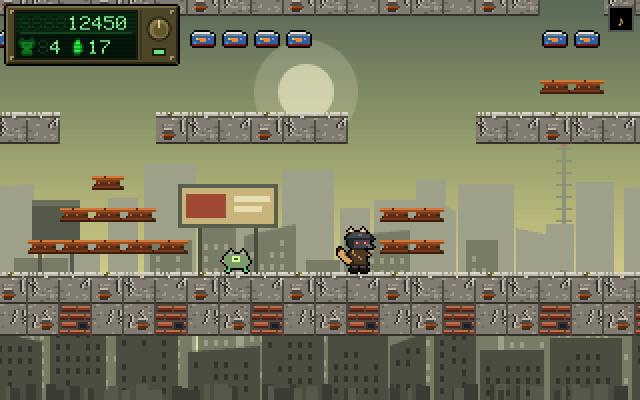
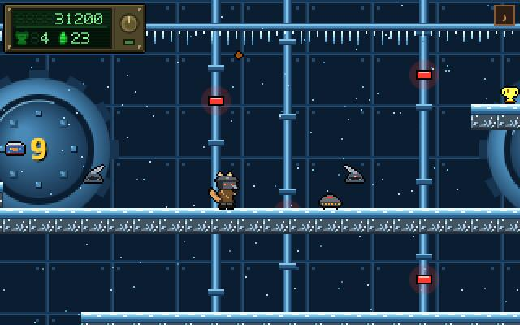
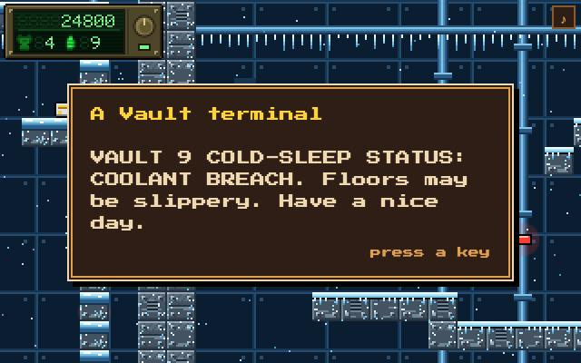
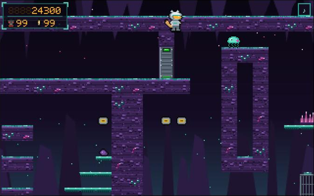
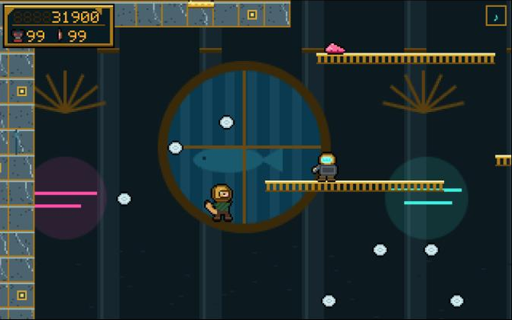
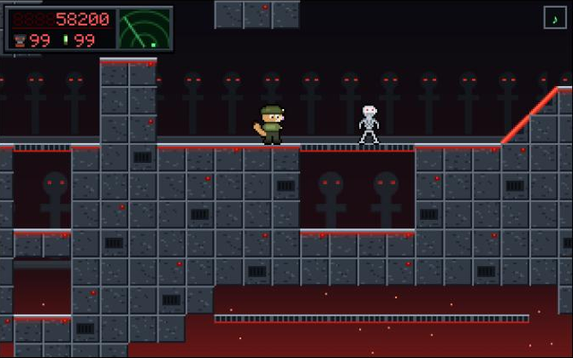

# Commander Poom

A platformer in the spirit of the Commander Keen games of 1990 and 1991, in
plain HTML and JavaScript: no build step, no dependencies, no framework. Each
Book is its own world with its own look, creatures, story and sound, and the
whole game, title screen included, dresses as the last Book played. Each
borrows the feeling of a famous game or film; its names, art and text are all
original.

| Book | | In the spirit of |
|---|---|---|
| 1 | **Wastelandia**: the Glow, a wasteland of raiders and old Vaults | *Fallout* |
| 2 | **Heavens to Mergatroid**: Thrum, a hollow moon with something alive inside | *Metroid* |
| 3 | **The Island of Dr Cal**: a villain's volcano lair, by night, on the quiet | *Metal Gear Solid* |
| 4 | **Descent into Raptura**: Raptura, a drowned art-deco city of otters | *BioShock* |
| 5 | **Termination Day**: TERMINUS, a machine's station overrun by an alien swarm. *Held back for now: built, but kept out of the game until its levels are proven winnable; `js/book5.js` says how to put it back.* | *The Terminator*, *Aliens*, *Predator* |

Play it at <https://greykit.com/games/commanderpoom/>.


## Run it

Clone the repo and open `index.html` in a browser. That's all it needs; it
runs straight from disk.

To serve it instead (the share-card maker in `tools/` needs this), start any
static server from the repo root:

```sh
python3 -m http.server 8765
```

and open <http://localhost:8765/>.

- **To play:** a current desktop or mobile browser. Keyboard, gamepad, or
  touch: on a touch screen the controls appear on screen.
- **Network:** none, except the pixel font, Press Start 2P, which comes from
  Google Fonts. Offline, the game runs in a fallback monospace.
- **Saves:** the saved game, high scores and settings live in the browser's
  `localStorage`, so they belong to that browser and that address: a copy
  opened from disk and one served on localhost keep separate saves.
  Settings → *Forget everything* clears them.
- **Sound:** synthesized in the page with Web Audio; no audio files. `M`, or
  the speaker in the top right corner, turns it off.
- **For the tools only:** Node (CI uses Node 20); `rsvg-convert`, and Python
  with Pillow, for the icons.

## Keys

| Keys | |
|---|---|
| `←` `→` | walk |
| `Ctrl` or `Z` | jump; hold it to jump higher |
| `Alt` or `X` | pogo stick on and off |
| `Space` or `C` | fire the raygun |
| `↑` `↓` | climb a pole |
| `↑` | read a sign; go through a door |
| `↓` + jump | drop through a ledge |
| `Enter` | status: score, lives, parts |
| `Esc` | pause |
| `M` | sound on and off |

On a gamepad, A jumps, B pogos and X fires. On the world map, walk onto a
level and press jump or fire to go in.

## The repo

| | |
|---|---|
| `index.html` | the page: markup, styles, and the script tags |
| `js/game.js` | the engine, the Books' words and themes, the UI |
| `js/art.js` | every sprite, tileset, backdrop and world map, drawn in code, for Books 1 and 2 |
| `js/art-book3.js`–`art-book5.js` | the same for Books 3, 4 and 5, each registering with `art.js` |
| `js/book5.js` | Book 5, held back: not loaded by `index.html`; its header says how to put it back |
| `js/books/A.js`–`I.js` | the levels, one file per map set, transcribed from `maps2/` |
| `js/gk-title.js` | the family's boot and title block, from `games-meta/canon` |
| `maps2/` | the level designs from the map builder, and their README |
| `docs/story/` | each Book's story (`book-<n>-story.md`), what its maps need from it (`book-<set>.md`), and ideas for the Books to come |
| `docs/art/` | sheets of the tilesets, Poom, the items and the creatures |
| `ENGINE-SUPPORT.md` | what each Book's maps ask of the engine |
| `REVIEW.md`, `review/` | the 2026-10-12 review, and the scripts that measured what it reports with the game's own code |
| `screenshots/` | the pictures in this README |
| `tools/` | the scripts below, plus the map transcriber and the story map |

Levels are addressed by map set and number: `H05` is set H, level 5. The four
Books in the game are sets **H, C, D and E**, in that order. Set A is Book 5,
held back with `js/book5.js`, and B, F, G and I are levels for Books still to
come. All five are in the repo; `index.html` loads B, F, G and I, but no Book
plays them yet, and leaves A out altogether.

### Tools

| | |
|---|---|
| `node tools/stamp-assets.js` | After editing anything in `js/`: refreshes the content hashes on the script tags in `index.html` (`game.js?v=1a2b3c4d`), so a deploy isn't hidden behind a cached copy. `--check` only reports. |
| `node tools/check-assets.js` | Fails if anything `index.html` or the manifest names is missing from the repo. CI runs it before every deploy. |
| `node tools/make-icons.js` | Draws `icon.svg`, Poom's head in Book 1's ranger helmet, and renders the favicons, app icons and touch icon from it (needs `rsvg-convert`, and Python with Pillow for `favicon.ico`). The outputs are committed. |
| `tools/og.html` | Draws the share card, `og.png`, by running the game in a hidden frame. Open it over http from the repo root, wait for its title to read *ready*, and save the canvas. |

### Debug

`?level=H05` drops straight into a level, with everything; `?book=H` onto that
Book's world map.

## Deploy

`main` deploys to DreamHost by rsync (`.gitlab-ci.yml`). Before it does, CI
runs `tools/check-assets.js` and `node --check` on every script, and stops the
deploy if either fails. What ships is `index.html`, `js/`, `og.png`, the icons
and the manifest; `maps2/`, `docs/`, `tools/`, `review/` and the Markdown
files stay in the repo.

## Screens

### The Glow








### The other Books








## License

MIT; see [LICENSE](LICENSE).
