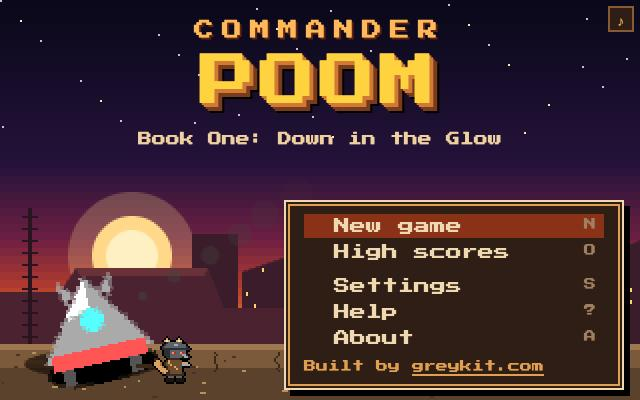
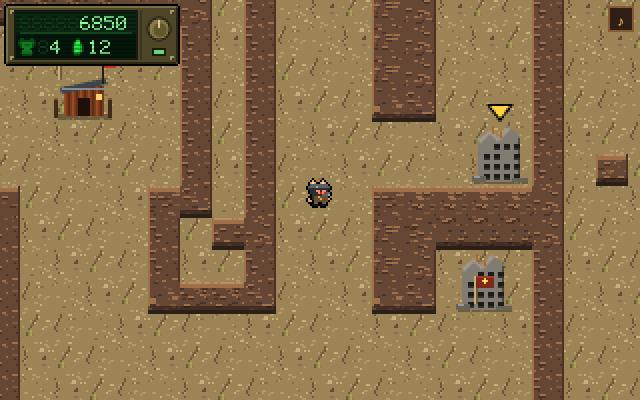
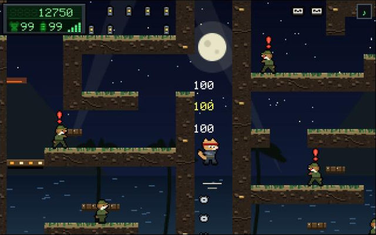

# Commander Poom

**A platformer in the spirit of the Commander Keen games of 1990 and 1991.** Each Book is its own world with its own look, creatures, story and sound, and the whole game, title screen included, dresses as the last Book played. Each borrows the feeling of a famous game or film; its names, art and text are all original.

**Play:** [greykit.com/games/commanderpoom](https://greykit.com/games/commanderpoom/)

| Book | | In the spirit of |
|---|---|---|
| 1 | **Wastelandia**: the Glow, a wasteland of raiders and old Vaults | *Fallout* |
| 2 | **Heavens to Mergatroid**: Thrum, a hollow moon with something alive inside | *Metroid* |
| 3 | **The Island of Dr Cal**: a villain's volcano lair, by night, on the quiet | *Metal Gear Solid* |
| 4 | **Descent into Raptura**: Raptura, a drowned art-deco city of otters | *BioShock* |

## How it plays

Walk Poom across each Book's world map, step onto a level and go in. Run, jump, pogo and fire the raygun through the level to its exit, collecting along the way.

## Keys

| Keys | |
|---|---|
| `←` `→` | walk |
| `Ctrl` or `Z` | jump; hold it to jump higher |
| `Alt` or `X` | pogo stick on and off |
| `Space` or `C` | fire the raygun |
| `↑` `↓` | climb a pole; `↑` reads a sign or goes through a door |
| `Enter` | status: score, lives, parts |
| `Esc` | pause |
| `M` | sound on and off |

On a gamepad, A jumps, B pogos and X fires. On a touch screen the controls appear on screen. The only thing fetched is the pixel font, from Google Fonts; offline, the game uses a fallback monospace.

## Saves

The saved game, high scores and settings live in the browser's `localStorage`. **Settings → Forget everything** clears them.

## Credits

Commander Keen is id Software's. Commander Poom is not affiliated with id Software or with the makers of the games and films its Books borrow from, and uses none of their code, art, sound or text.

Typeface: Press Start 2P, from Google Fonts.

Working on the game: [DEVELOPMENT.md](DEVELOPMENT.md).

By Matthew "Shan" Romanek, with Claude. Built by [greykit.com](https://greykit.com/).

Made for my own play. Nothing here is offered: no support, no updates, no licence.
